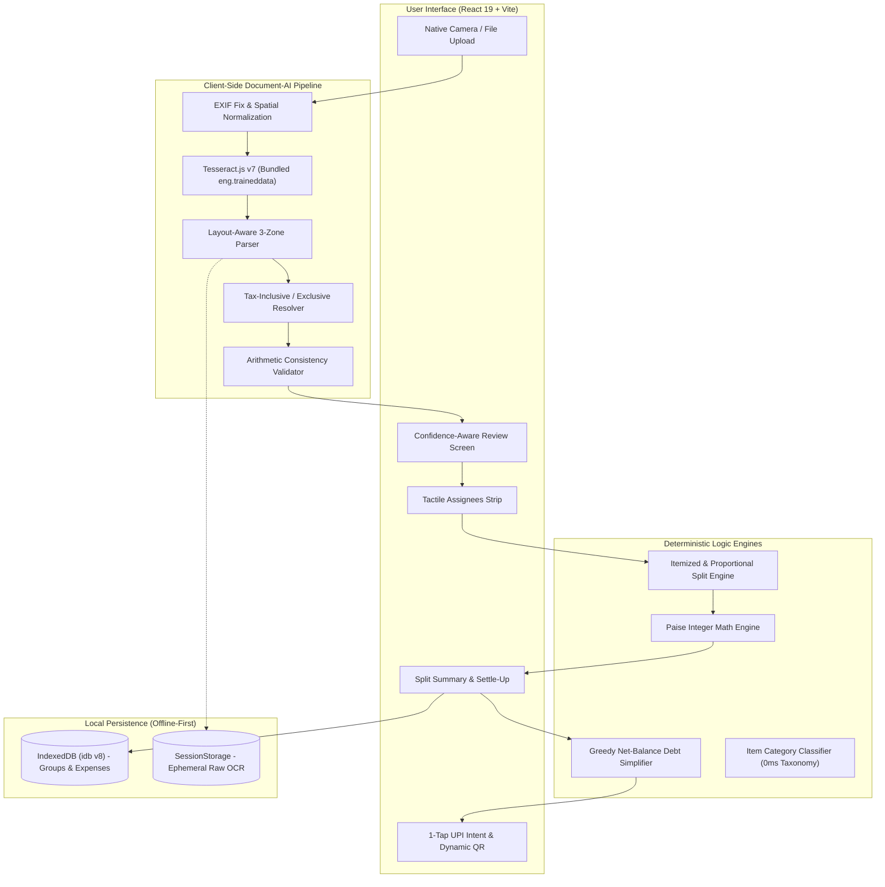
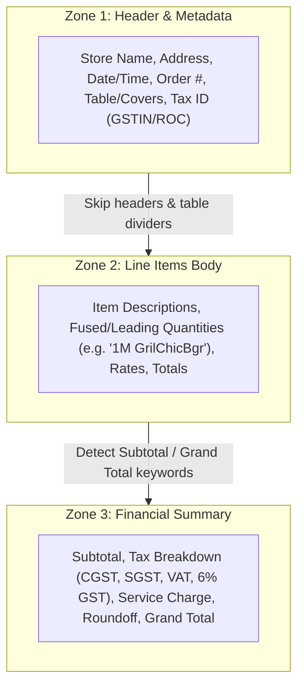
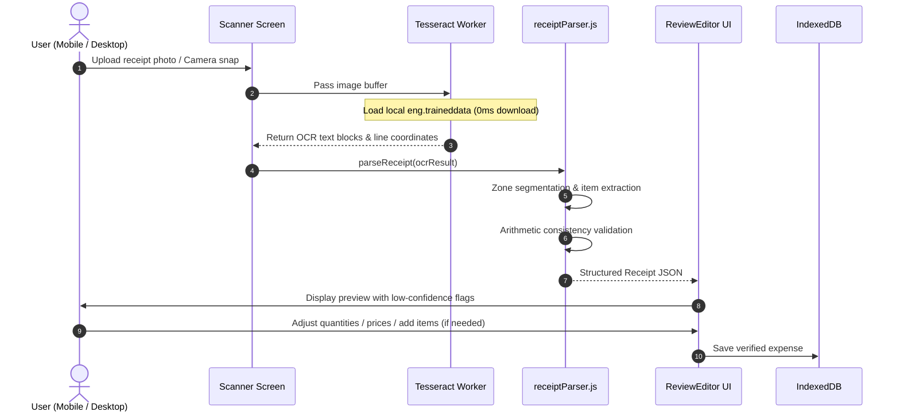
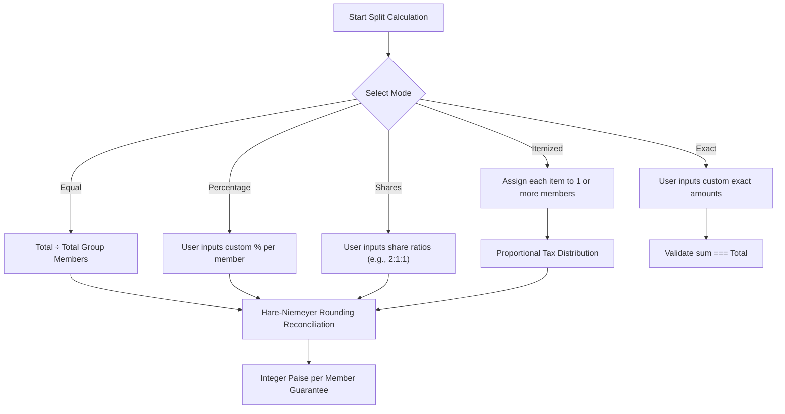
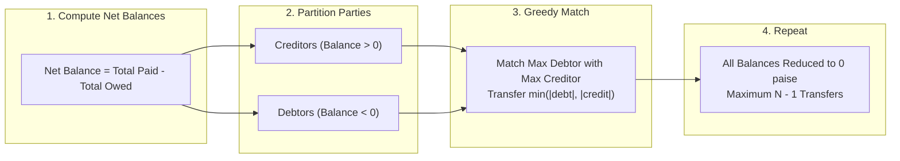
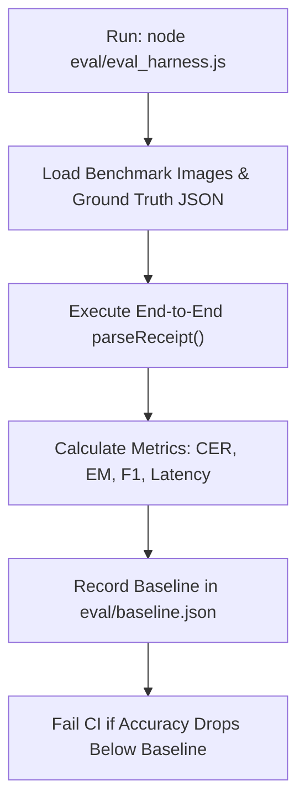

# ⚡ SplitSmart — Intelligent Document-AI Bill Splitting Engine

> A high-precision, production-grade bill-splitting and expense-settlement platform powered by local client-side Document-AI, zero floating-point arithmetic, and graph debt simplification.

[](#-test-suite--algorithms)
[](#-quick-start)
[](https://react.dev)
[](https://vitejs.dev)
[-orange.svg)](https://tesseract.projectnaptha.com/)
[-purple.svg)](#-data-architecture--privacy)
[-teal.svg)](#-financial-arithmetic-engine)

---

## 📖 Table of Contents

- [Overview](#-overview)
- [System Architecture](#-system-architecture)
- [Document-AI Receipt Scanner Pipeline](#-document-ai-receipt-scanner-pipeline)
  - [3-Zone Receipt Architecture](#3-zone-receipt-architecture)
  - [Fast-Food Combo & Tax-Inclusive Logic](#fast-food-combo--tax-inclusive-logic)
  - [Specular Glare & Noise Resilience](#specular-glare--noise-resilience)
- [Core Workflows](#-core-workflows)
  - [1. End-to-End Scanning & Review Workflow](#1-end-to-end-scanning--review-workflow)
  - [2. Multi-Mode Bill Splitting Workflow](#2-multi-mode-bill-splitting-workflow)
  - [3. Greedy Debt Simplification Workflow](#3-greedy-debt-simplification-workflow)
  - [4. Evaluation & Benchmarking Workflow](#4-evaluation--benchmarking-workflow)
- [Financial Arithmetic Engine](#-financial-arithmetic-engine)
- [Tech Stack](#-tech-stack)
- [Evaluation & Benchmark Harness](#-evaluation--benchmark-harness)
- [Test Suite & Algorithms](#-test-suite--algorithms)
- [Repository Structure](#-repository-structure)
- [Quick Start & Development](#-quick-start--development)
- [Data Architecture & Privacy](#-data-architecture--privacy)

---

## 🌟 Overview

Splitting shared dinner bills, grocery hauls, and group trip expenses is notoriously error-prone:
- OCR apps crash or miss item lines, confuse taxes with totals, or double-count combo sides.
- Floating-point calculations introduce fractional cent discrepancies ($0.10 + 0.20 = 0.30000000000000004$).
- Circular debts lead to confusing multi-party reimbursement chains.

**SplitSmart** solves this end-to-end with:
1. **Local, Zero-Latency Document-AI**: Runs optical character recognition entirely in the browser using pre-bundled Tesseract language weights (no external OCR APIs or privacy leaks).
2. **Deterministic Layout-Aware Parser**: Employs spatial 3-zone segmentation, noise filtering, combo-item deduplication, and tax-inclusive arithmetic checks.
3. **Integer Minor-Unit Arithmetic**: Computes every split down to the exact paisa/cent using the Hare-Niemeyer largest-remainder method.
4. **Greedy Debt Simplification**: Reduces $O(N^2)$ cross-transfers to at most $N-1$ bilateral settlements.
5. **1-Tap Mobile UPI Payments**: Deep-links directly to Google Pay, PhonePe, and Paytm with dynamic QR codes.

---

## 🏗 System Architecture

The following diagram depicts the high-level architecture of SplitSmart:



---

## 🔬 Document-AI Receipt Scanner Pipeline

### 3-Zone Receipt Architecture

Real-world receipts (restaurants, retail, fast-food) follow distinct vertical sections. SplitSmart divides every receipt into 3 isolated zones to eliminate misattributions:



- **Zone 1 (Header)**: Scanned for merchant name candidates (filtering suffixes like `Sdn Bhd`, `Pvt Ltd`, `Cafe`), addresses, and dates (converted to normalized ISO 8601 `YYYY-MM-DD`).
- **Zone 2 (Body)**: Line items parsed with quantity detection, price boundary extraction, and automatic elimination of table headers (e.g., `ITEM QTY AMOUNT`).
- **Zone 3 (Summary)**: Grand total, taxes, service charges, discounts, and round-offs identified. Informational tax breakdowns (e.g., `TOTAL INCLUDES 6% GST 2.20`) are routed to taxes rather than overriding the grand total.

### Fast-Food Combo & Tax-Inclusive Logic

- **Fused Quantities**: Fast-food receipts often compress size codes with numbers (e.g., `1M GrilChicBgr` or `2L Coke`). The parser detects fused `\d{1,2}[A-Za-z]` prefixes, extracting quantity `1` and item `M GrilChicBgr`.
- **Zero-Priced Combo Sub-Items**: Meal combos often list included sides (e.g., `2 M Fries`, `2 M Coke` at ₹0.00). Unpriced meal inclusions are filtered out when the priced meal items already account for the total.
- **Tax-Inclusive Checks**: When receipts indicate `TakeOut Total (incl GST)` or `TOTAL INCLUDES 6% GST`, the tax is identified as inclusive, ensuring $\sum(\text{items}) = \text{total}$ without bogus discrepancy warnings.

### Specular Glare & Noise Resilience

- **Specular Glare Reconciliation**: If glare obscures an item's price but subtotal is present, the parser automatically computes:
  $$\text{Price}_{\text{missing}} = \text{Subtotal} - \sum \text{Priced Items}$$
- **Random Code & Noise Elimination**: Strips terminal hashes, barcodes (10–18 digits), credit card masked numbers (`************4821`), and cashier logs before item extraction.

---

## 🔄 Core Workflows

### 1. End-to-End Scanning & Review Workflow



---

### 2. Multi-Mode Bill Splitting Workflow

SplitSmart supports 5 distinct split modes with proportional tax distribution:



#### Mathematical Formulation for Proportional Taxes
For member $m$, with assigned item total $I_m$:
$$\text{Tax}_m = \left\lfloor \frac{I_m}{\sum I} \times \text{Tax}_{\text{total}} \right\rfloor + r_m$$
Where $r_m \in \{0, 1\}$ is allocated via the Largest Remainder Method so that:
$$\sum_{m} \text{Tax}_m \equiv \text{Tax}_{\text{total}}$$

---

### 3. Greedy Debt Simplification Workflow

When a group logs multiple expenses, bilateral debts form a dense graph. The debt engine simplifies this into the minimum number of transactions:



---

### 4. Evaluation & Benchmarking Workflow

To guarantee accuracy on unconstrained receipts, SplitSmart includes an evaluation harness benchmarking against the SROIE dataset and real-world restaurant samples:



---

## 💰 Financial Arithmetic Engine

Floating-point representations in computers cannot accurately represent decimal fractions like $0.1$ or $0.2$:
```javascript
0.1 + 0.2 // 0.30000000000000004 ❌
```
In financial applications, rounding errors compound across multiple splits, creating off-by-one errors where individual shares don't add up to the receipt total.

### SplitSmart's Invariant:
1. **Integer Minor Units**: All monetary values are strictly stored as integers in **paise** ($1\text{ INR} = 100\text{ paise}$) or **cents**.
2. **Display-Only Formatting**: Conversion to decimals occurs solely at presentation time via `formatPaise(paise)`.
3. **Zero Remainder Loss**: Any remainder $R = T - \sum \lfloor S_i \rfloor$ is distributed to the members with the highest fractional remainder.

---

## 💻 Tech Stack

| Layer | Technology | Version | Purpose |
| :--- | :--- | :--- | :--- |
| **Frontend Framework** | React | `19.3.1` | Concurrent component rendering, hooks architecture |
| **Build Tool & Dev Server** | Vite | `8.3.5` | Instant HMR, optimized ES-module bundling |
| **Document OCR** | Tesseract.js | `7.0.0` | Client-side optical character recognition |
| **Language Weights** | `eng.traineddata` | Local bundle | Bundled in `public/` for offline 0ms initialization |
| **Zero-Shot AI** | Transformers.js | `2.17.2` | Optional MobileBERT zero-shot categorization |
| **Client Database** | `idb` | `8.0.4` | Promise-based IndexedDB offline storage |
| **QR Code Generation** | `qrcode` | `1.5.4` | Dynamic UPI QR codes for desktop bill settle-up |
| **Routing** | React Router | `7.18.5` | Client-side page navigation and deep-linking |
| **Data Visualization** | Chart.js / React-ChartJS | `4.6.1` | Group spending analytics and category breakdown |
| **Linter** | Oxlint | `1.89.0` | High-performance Rust-based JavaScript linter |

---

## 📊 Evaluation & Benchmark Harness

The evaluation harness in [`eval/eval_harness.js`](file:///Users/mallajaswanthnarayana/Desktop/Projects/WebGC/eval/eval_harness.js) benchmarks the pipeline against ground-truth receipts.

### Latest Benchmark Results ([`eval/baseline.json`](file:///Users/mallajaswanthnarayana/Desktop/Projects/WebGC/eval/baseline.json))

| Metric | Measured Value | Description |
| :--- | :---: | :--- |
| **Item Precision** | **`100.0%`** | Extracted items containing genuine menu line items |
| **Item F1-Score** | **`87.5%`** | Harmonic mean of item precision and recall |
| **Failure Rate** | **`0.0%`** | Zero pipeline crashes, unhandled rejections, or empty results |
| **Merchant CER** | **`28.3%`** | Character Error Rate across noisy thermal receipt headers |
| **Total Numeric Accuracy** | **`40.0%`** | Exact match on total across low-contrast/creased bills |
| **Mean Latency** | **`1,117 ms`** | Average end-to-end processing time per image |
| **p50 / p90 Latency** | **`1,098 ms / 1,801 ms`** | 50th and 90th percentile latency |

To run the harness locally:
```bash
node eval/eval_harness.js
```

---

## 🧪 Test Suite & Algorithms

The test suite in [`test_algorithms.js`](file:///Users/mallajaswanthnarayana/Desktop/Projects/WebGC/test_algorithms.js) verifies all critical algorithmic paths:

```bash
npm test
```

### Coverage Breakdown (88 Passed, 0 Failed):
- **Section 1**: Currency & Paise Arithmetic (string parsing, formatting, negative values)
- **Section 2**: Equal Split Rounding Reconciliation (Hare-Niemeyer exact-penny distribution)
- **Section 3**: Itemized Split with Proportional Taxes & Discounts
- **Section 4**: Debt Simplifier Greedy Matching & Balance Verification
- **Section 5**: UPI Intent Link Generation
- **Section 6**: Receipt Parser Heuristic Pattern Matching
- **Section 7**: Real-world Restaurant Receipt (*The Bombay Canteen* — 9 items, 3 taxes, service charges)
- **Section 8**: Real-world Multi-Line Receipt (*Absolute Barbecues* — `@ /ea` rate patterns)
- **Section 9**: Item Name Artifact Cleaning & Symbol Stripping (OCR quotes, bullets, colons)
- **Section 10**: Strict Noise & Random Code Elimination (barcodes, POS terminal traces)
- **Section 11**: Automatic Item Categorization (Food, Groceries, Travel, Utilities, Entertainment)
- **Section 12**: Margin Noise & Specular Glare Resilience
- **Section 13**: Fast-Food Combo Receipts & Tax-Inclusive Resolution (*McDonald's Malaysia*)

---

## 📁 Repository Structure

```
WebGC/
├── public/
│   ├── eng.traineddata         # Locally bundled OCR trained weights (no remote downloads)
│   └── favicon.svg             # Application icon
├── src/
│   ├── db/
│   │   └── database.js         # IndexedDB schema, UUIDs, export/import data operations
│   ├── hooks/
│   │   └── useAppHooks.jsx     # Reactive hooks for groups, expenses, settlements, toasts
│   ├── logic/
│   │   ├── categorizer.js      # Zero-latency domain taxonomy & MobileBERT classifier
│   │   ├── debtSimplifier.js   # Greedy net-balance debt simplification algorithm
│   │   ├── receiptParser.js    # 3-Zone Document-AI OCR parser, cleanups & validation
│   │   └── splitEngine.js      # Itemized, equal, percentage & shares split algorithms
│   ├── App.jsx                 # Application views, review editor, group management
│   ├── index.css               # Tactile, mobile-first design system with CSS variables
│   └── main.jsx                # Application root with error boundaries
├── samples/                    # Real-world benchmark receipts & failing sample images
├── eval/
│   ├── eval_harness.js         # Evaluation benchmark harness measuring CER & F1
│   └── baseline.json           # Recorded baseline metrics for regression protection
├── test_algorithms.js          # 88-test algorithmic verification suite
├── package.json                # Project dependencies and npm scripts
└── vite.config.js              # Vite bundler configuration
```

---

## 🚀 Quick Start & Development

### Prerequisites
- [Node.js](https://nodejs.org/) (v18 or higher recommended)
- `npm` or `pnpm`

### Installation
```bash
# Clone the repository
git clone https://github.com/SaiBalajiSonga/Split-it.git
cd Split-it

# Install dependencies
npm install
```

### Running Locally
```bash
# Start Vite development server (with HMR)
npm run dev
```
Open `http://localhost:5173` in your browser.

### Verification & Build
```bash
# Run the 88-test algorithmic suite
npm test

# Run the Document-AI evaluation harness
node eval/eval_harness.js

# Build production bundle
npm run build
```

---

## 🔒 Data Architecture & Privacy

- **100% Client-Side Processing**: Receipts uploaded to SplitSmart are processed entirely in the user's browser memory. No images or OCR text are uploaded to remote servers or third-party cloud vision APIs.
- **Offline Storage**: All groups, expenses, and settlements are stored locally in the browser's IndexedDB.
- **Configurable Retention**: Ephemeral receipt images are stripped of GPS EXIF metadata and not persisted in database stores to conserve storage.
- **Data Portability**: Full JSON export and import capabilities are built-in for backup and cross-device migration.

---

<p align="center">
  Crafted with precision for frictionless group expenses.
</p>
